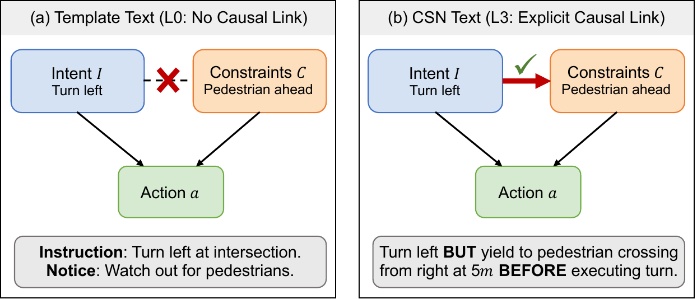
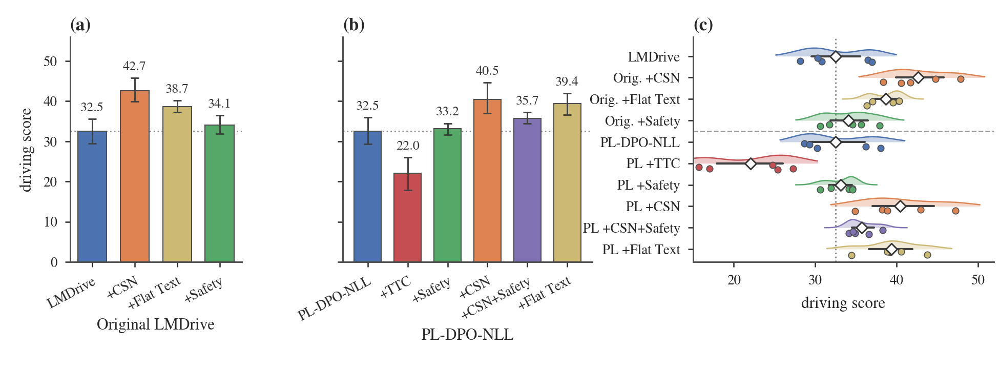
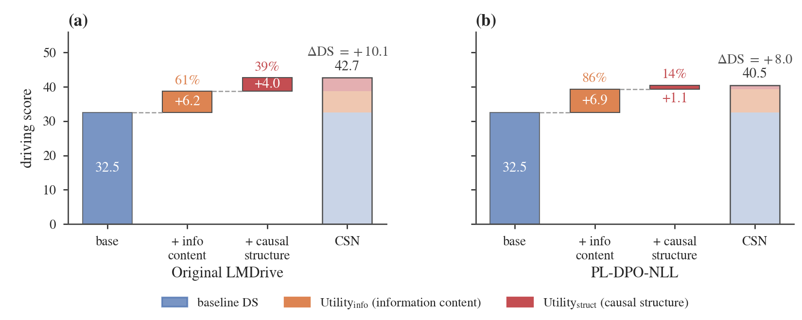
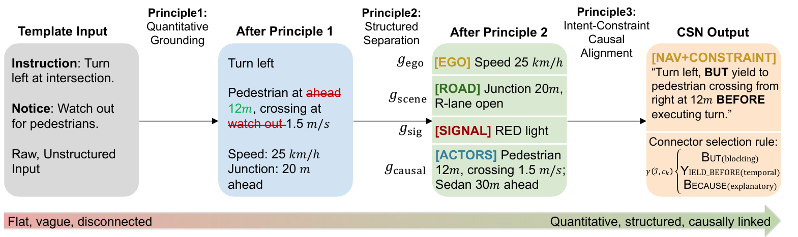

<h1 align="center">Causal Scene Narration:<br>Inference-Time Text Restructuring for Vision-Language-Action Driving</h1>

<p align="center">
Yun Li<sup>1</sup>, Yidu Zhang<sup>1</sup>, Simon Thompson<sup>2</sup>, Ehsan Javanmardi<sup>1</sup>, Manabu Tsukada<sup>1</sup><br>
<sup>1</sup>The University of Tokyo &nbsp;&nbsp; <sup>2</sup>TIER IV, Inc.
</p>

<p align="center">
<a href="https://openreview.net/forum?id=sJATIdx6jG"></a>

</p>

<p align="center"></p>

> CSN improves the CARLA Driving Score by +31.1% on original LMDrive and +24.5% on the preference-aligned variant, with no retraining and no extra GPU memory.

Paper: [OpenReview](https://openreview.net/forum?id=sJATIdx6jG) (Transactions on Machine Learning Research)

## Overview

Vision-Language-Action (VLA) driving models such as LMDrive receive the navigation command and the hazard notices as separate text fragments. Causal Scene Narration (CSN) rewrites this text at inference time. Each constraint that matters for the current maneuver is linked to the command with a causal connective, carries measured distances and speeds, and is kept apart from the background context. CSN runs on the CPU and does not change the model weights.

On 16 CARLA routes in 8 towns with five repetitions, CSN raises the Driving Score (DS) of LMDrive by 31.1% with the original weights and by 24.5% with a LoRA adapter trained on driving preferences. Flat Text, which gives the same facts without the connectives, already brings most of this gain (+6.17 DS and +6.88 DS). The connectives add 39.1% of the gain on the original weights (95% bootstrap CI [6.6%, 71.4%]) and 13.5% on the LoRA weights (95% CI [-244%, 41.9%]). The gain remains under distance errors up to ±5 m, speed noise up to ±30% and 20% missed actors. Adding the runtime direction-conflict monitor to CSN on the LoRA weights lowers DS from 40.45 to 35.74; [Notes on the code](#notes-on-the-code) describes what the monitor changes in these runs.

## Key results

Mean Driving Score over five repetitions of the 16-route benchmark (± half-width of the 95% bootstrap CI):

| Weights | Template text | + Flat Text (same facts, no connectives) | + CSN |
|---|---:|---:|---:|
| Original LMDrive | 32.54 ± 3.00 | 38.71 ± 1.44 | 42.67 ± 2.74 |
| LoRA adapter (PL-DPO-NLL in the paper) | 32.49 ± 3.34 | 39.38 ± 2.66 | 40.45 ± 3.79 |

The paper calls the LoRA weight configuration PL-DPO-NLL.

<p align="center"></p>

<p align="center"></p>

## Method

<p align="center"></p>

CSN reads the scene from the CARLA Python API on the CPU (actors, traffic light, speed limit, road topology, weather), keeps the constraints that matter for the current navigation command, ranks them, and links each one to the command with a causal connective: BUT for a blocking constraint, YIELD BEFORE for a moving actor that crosses the intended path, and BECAUSE for context outside the conflict zone. The model weights are not changed. The renderer is `leaderboard/team_code/scene_text_enrichment.py`; `LMDRIVE_TEXT_FLAT=true` renders the same facts without connectives (the Flat Text condition).

## What this repository contains

| Folder | What it holds |
|---|---|
| `results/` | Per-route CARLA Leaderboard outputs of every closed-loop run in the paper (JSON), plus token statistics and runtime-monitor intervention counts |
| `analysis/reproduce_paper_numbers.py` | Recomputes the numbers of the paper from `results/` and prints them next to the paper's values |
| `analysis/summarize_logs.py` | Builds the token and intervention summaries from your own runs |
| `figures/` | Scripts that draw the two data figures of the paper from `results/` |
| `leaderboard/team_code/` | The agent code that produced `results/`: CSN and the other text renderers, the modified LMDrive agent, the runtime monitors and the agent configuration. These files go into an LMDrive checkout |
| `scripts/` | Installation into LMDrive, one-run launcher, the full list of paper runs, and packing of the LoRA weights |
| `examples/render_text_styles.py` | Prints every text style for one synthetic scene, without CARLA or a GPU |
| `weights/` | Configuration and checksums of the LoRA adapter attached to the GitHub release |
| `assets/` | Images on this page |

## Quick start

```bash
pip install -r requirements.txt
python analysis/reproduce_paper_numbers.py
python examples/render_text_styles.py
python figures/plot_ds_comparison.py        # figures are written to figures/out/
python figures/plot_ig_decomposition.py
```

These commands need only the files in this repository.

<details>
<summary><b>Names used in the paper and in the result files</b></summary>

<br>

| Paper | Files |
|---|---|
| LMDrive (original) | `multitown_ablation/original_lmdrive_rep*.json` |
| + CSN (Original LMDrive) | `multitown_ablation/original_csn_rep*.json` |
| + Flat Text (Original LMDrive) | `multitown_ablation/original_flat_text_rep*.json` |
| + Semantic Safety (Original LMDrive) | `multitown_ablation/original_semantic_safety_rep*.json` |
| + PL-DPO-NLL (its baseline) | `multitown_ablation/baseline_rep*.json` |
| PL-DPO-NLL + TTC Safety | `multitown_ablation/ttc_safety_rep*.json` |
| PL-DPO-NLL + Semantic Safety | `multitown_ablation/semantic_safety_rep*.json` |
| PL-DPO-NLL + CSN | `multitown_ablation/csn_only_rep*.json` |
| PL-DPO-NLL + CSN+Safety | `multitown_ablation/csn_semantic_safety_rep*.json` |
| PL-DPO-NLL + Flat Text | `multitown_ablation/flat_text_rep*.json` |
| DriveVLM-style, compressed / verbatim | `baseline_comparison/original_drivevlm_rep*.json` / `original_drivevlm_faithful_rep*.json` |
| DriveLM-style, compressed / verbatim | `baseline_comparison/original_drivelm_rep*.json` / `original_drivelm_faithful_rep*.json` |
| Noise Mild / Moderate / Severe / Extreme | `noise_ablation/noise_{mild,moderate,severe,extreme}_rep*.json` |
| Noise, Clean (N=6) | the five `original_csn` runs and `noise_ablation/clean_rep6.json` |
| Flat Text + Severe (control) | `noise_ablation/flat_noise_severe_rep*.json` |
| Intervention logging | `intervention_logging/{baseline,csn}_{safety,nosafety}_rep*.json` and `intervention_counts.json` |

`intervention_logging/baseline_safety_rep4.json` and `csn_safety_rep5.json` are unfinished repetitions (0 and 8 of 16 route records). The paper does not use them.

The same names are the configuration names of `scripts/run_eval.sh`. Each result file is one repetition over the 16 routes; `_checkpoint.records` holds the per-route Driving Score (`score_composed`), Route Completion (`score_route`) and Infraction Score (`score_penalty`).

</details>

<details>
<summary><b>Where each result in the paper comes from</b></summary>

<br>

| Paper | Files |
|---|---|
| Table 3 and Fig. 5: multi-town ablation, ten configurations | `results/multitown_ablation/` |
| Sec. 5.3, Eq. 3 and Fig. 6: information vs structure decomposition, bootstrap CIs, per-route wins/ties/losses | `results/multitown_ablation/` (Original and PL-DPO-NLL baseline, Flat Text and CSN rows) |
| Table 4 and the bottom block of Table 1: DriveVLM-style and DriveLM-style text | `results/baseline_comparison/` |
| Sec. 5.4: tokens per frame (DriveVLM-style and DriveLM-style runs; no CSN run was logged) | `results/token_stats/token_stats_summary.json` |
| Table 5 and Sec. 5.5.2: perception noise and the Flat Text control | `results/noise_ablation/` and `results/multitown_ablation/original_{csn,flat_text}_rep*.json` |
| Sec. 5.2.4: interventions of the direction-conflict monitor (repetitions 1 to 3, 96 routes) | `results/intervention_logging/intervention_counts.json` |

`analysis/reproduce_paper_numbers.py` recomputes all of these.

</details>

<details>
<summary><b>Notes on the protocol</b></summary>

<br>

- **Benchmark.** The 16 routes in 8 towns are LMDrive's LangAuto short benchmark, `langauto/benchmark_short.xml` in the LMDrive repository, with the official traffic scenarios `leaderboard/data/official/all_towns_traffic_scenarios_public.json`.
- **Repetitions.** Each repetition is a separate evaluator run with a fresh CARLA server at High quality (1280x720). The evaluator seeds are the Leaderboard defaults in every repetition (traffic manager seed 1, data provider seed 2000), so repetitions differ through simulator nondeterminism.
- **Noise.** The noise is injected into the scene state that the renderer reads (distances, speeds, missed actors), with a generator seeded with 42 for each route.
- **Statistics.** Table 3 and Table 4 report the half-width of a percentile bootstrap CI over repetitions (10,000 resamples). In Table 5 the Clean and Flat Text rows use the sample SD and a normal-approximation CI; the four noise rows use the population SD and a percentile bootstrap CI. The analysis script uses the same procedures and seeds.
- **Hardware.** All closed-loop runs used one NVIDIA RTX 3090 Ti (24 GB). One repetition of 16 routes takes 40 to 100 minutes. The LoRA adapter was trained on 3 NVIDIA RTX 6000 Ada GPUs.

</details>

## Running the closed-loop evaluation

The agent runs inside [LMDrive](https://github.com/opendilab/LMDrive) on CARLA 0.9.10.1.

1. Install CARLA 0.9.10.1 with the additional maps, and LMDrive with its conda environment (Python 3.8, PyTorch 2.0.1, transformers 4.28.0), following the LMDrive README. Then install the extra packages used for the LoRA rows:
   ```bash
   pip install -r requirements-agent.txt
   ```
2. Download the model files:

   | Environment variable | File | Source |
   |---|---|---|
   | `LMDRIVE_LLM_MODEL` | `llava-v1.5-7b/` | [liuhaotian/llava-v1.5-7b](https://huggingface.co/liuhaotian/llava-v1.5-7b) |
   | `LMDRIVE_VISION_CKPT` | `vision-encoder-r50.pth.tar` | [OpenDILabCommunity/LMDrive-vision-encoder-r50-v1.0](https://huggingface.co/OpenDILabCommunity/LMDrive-vision-encoder-r50-v1.0) |
   | `LMDRIVE_LMDRIVE_CKPT` | `llava-v1.5-checkpoint.pth` | [OpenDILabCommunity/LMDrive-llava-v1.5-7b-v1.0](https://huggingface.co/OpenDILabCommunity/LMDrive-llava-v1.5-7b-v1.0) |
   | `CSN_LORA_DIR` | `CausalSceneNarration_lora_v1/` (LoRA rows only) | [liyun0607/CausalSceneNarration-LoRA](https://huggingface.co/liyun0607/CausalSceneNarration-LoRA), or the unpacked `CausalSceneNarration_lora_v1.zip` from the GitHub release of this repository |

   The SHA-256 of the two LMDrive files used in the paper are `718c7f1a…076a` (vision encoder) and `1d3c934a…0091` (LLaVA-v1.5 checkpoint), the same as on Hugging Face.
3. Copy the agent files into the LMDrive checkout and run one configuration:
   ```bash
   bash scripts/install_into_lmdrive.sh /path/to/LMDrive
   export CARLA_ROOT=/path/to/CARLA_0.9.10.1 LMDRIVE_ROOT=/path/to/LMDrive
   export LMDRIVE_LLM_MODEL=... LMDRIVE_VISION_CKPT=... LMDRIVE_LMDRIVE_CKPT=... CSN_LORA_DIR=...
   bash scripts/run_eval.sh original_csn 1 runs/multitown_ablation
   ```
   `run_eval.sh` starts a new CARLA server for every run with `-windowed`, so CARLA needs an X display (set `DISPLAY`); the paper's runs used one. `CARLA_ARGS` replaces these window flags. The script stops if the result file already exists, because the Leaderboard evaluator reads `--resume=False` as true and would continue the old file.
4. To repeat a whole table, run `bash scripts/run_paper_experiments.sh <group> runs` for the groups `multitown`, `baselines`, `noise` and `interventions`, then
   ```bash
   python analysis/summarize_logs.py runs
   python analysis/reproduce_paper_numbers.py --results runs
   ```
   Sections whose result files are missing are skipped. The decomposition and the noise table also read the `multitown` runs. The `interventions` group saves per-frame images through `SAVE_PATH`, because the monitor writes its per-route summary next to them.

The switches read by the agent are:

| Variable | Values | Effect |
|---|---|---|
| `LMDRIVE_TEXT_ENRICHMENT` | `true` / `false` | replace LMDrive's notice text with a rendered scene text |
| `LMDRIVE_TEXT_STYLE` | `csn`, `drivevlm`, `drivevlm_faithful`, `drivelm`, `drivelm_faithful` | which renderer |
| `LMDRIVE_TEXT_FLAT` | `true` / `false` | CSN facts without connectives (Flat Text) |
| `CSN_NOISE_DIST_STD`, `CSN_NOISE_SPEED_REL`, `CSN_NOISE_MISS_RATE` | numbers | perception noise on the renderer's input |
| `LMDRIVE_SAFETY_ENABLED`, `LMDRIVE_SAFETY_TYPE` | `true`/`false`; `advanced` (direction-conflict monitor) or `ttc` | runtime monitor |
| `LMDRIVE_LORA_PATH` | adapter directory or `none` | LoRA adapter on the language model |
| `LMDRIVE_TOKEN_LOG_PATH` | file path | write per-frame token estimates |
| `SAVE_PATH` | directory or `none` | per-frame images and, with a monitor, the per-route intervention summary |

## Notes on the code

- **Which channel carries the text.** LMDrive has an instruction channel and a notice channel. The agent keeps LMDrive's template instruction, because changing the instruction resets LMDrive's visual feature buffer. Every renderer returns two strings; the first one (for CSN, the causal narration) is sent through the notice channel, unless LMDrive's own scenario notice is active, which keeps priority. The second string (for CSN, the `[EGO] [ROAD] [ACTORS] [SIGNAL]` summary) is used only if the first one is empty. `examples/render_text_styles.py` prints both strings.
- **Notice length.** LMDrive tokenizes the notice with the LLaMA tokenizer and keeps at most 64 tokens, cutting from the left. The renderer budgets its text with the estimate `(len(text) + 2) // 4`, which counts fewer tokens than the LLaMA tokenizer. In the example scene of `examples/render_text_styles.py` the CSN string is estimated at 43 tokens and has 61 LLaMA tokens with the start token, so it just fits; a longer CSN string within the renderer's budget of 58 estimated tokens can exceed 64 LLaMA tokens and then loses its first words, which state the intended maneuver. The DriveVLM-style string of the same scene is estimated at 52 tokens, has 69 LLaMA tokens and is cut. How often this happened during the runs was not logged. The token counts in `results/token_stats/` use the same estimate.
- **Scene extraction.** Vehicles within 50 m and pedestrians within 30 m are read, excluding actors more than 5 m (vehicles) or 3 m (pedestrians) behind the ego vehicle; the three nearest vehicles and two nearest pedestrians are scored. Fragments are added until the token estimate `(len(text) + 2) // 4` reaches 58.

## Weights

The LoRA adapter of the rows that the paper calls PL-DPO-NLL is on Hugging Face at [liyun0607/CausalSceneNarration-LoRA](https://huggingface.co/liyun0607/CausalSceneNarration-LoRA) and is attached to the GitHub release as `CausalSceneNarration_lora_v1.zip` (about 290 MB). It unpacks to a folder `CausalSceneNarration_lora_v1/` with `adapter_model.safetensors`, `adapter_config.json` and `MANIFEST.json`; set `CSN_LORA_DIR` to this folder. The adapter has rank 32 and alpha 32 on the q, k, v, o, gate, up and down projections of all 32 layers. The agent loads it with `peft.PeftModel.from_pretrained` onto the language model of LMDrive-LLaVA-v1.5-7B. `weights/MANIFEST.json` lists the SHA-256 of the files, and `scripts/pack_lora_release.sh` builds the archive from the trained adapter and checks them. The adapter is applied to a Llama 2 based language model, so using it is also subject to the Llama 2 Community License.

## What is not included

- CARLA, the LMDrive code and the LMDrive and LLaVA checkpoints. They are downloaded from their own sources (see above); this repository only adds files to `leaderboard/team_code/` of LMDrive.
- The training code and the preference data of the LoRA adapter. The training script we still have is a later version than the one that produced this adapter.
- Evaluator logs and the per-frame images saved during the runs.

## Citation

The same entry is in `CITATION.bib`; GitHub also reads `CITATION.cff`.

```bibtex
@article{li2026causal,
  title   = {Causal Scene Narration: Inference-Time Text Restructuring for Vision-Language-Action Driving},
  author  = {Li, Yun and Zhang, Yidu and Thompson, Simon and Javanmardi, Ehsan and Tsukada, Manabu},
  journal = {Transactions on Machine Learning Research},
  issn    = {2835-8856},
  year    = {2026},
  url     = {https://openreview.net/forum?id=sJATIdx6jG}
}
```

## Acknowledgments

This work was supported by JSPS KAKENHI Grant Number JP26KJ0799 and by TIER IV, Inc. The agent builds on [LMDrive](https://github.com/opendilab/LMDrive), and the runs use the [CARLA](https://carla.org) simulator and Leaderboard.

## License

The code is released under the Apache License 2.0 (see `LICENSE`). `leaderboard/team_code/lmdriver_agent.py` is a modified version of LMDrive's agent, also under the Apache License 2.0; see `NOTICE`. The LoRA weights in the GitHub release are also subject to the Llama 2 Community License.
